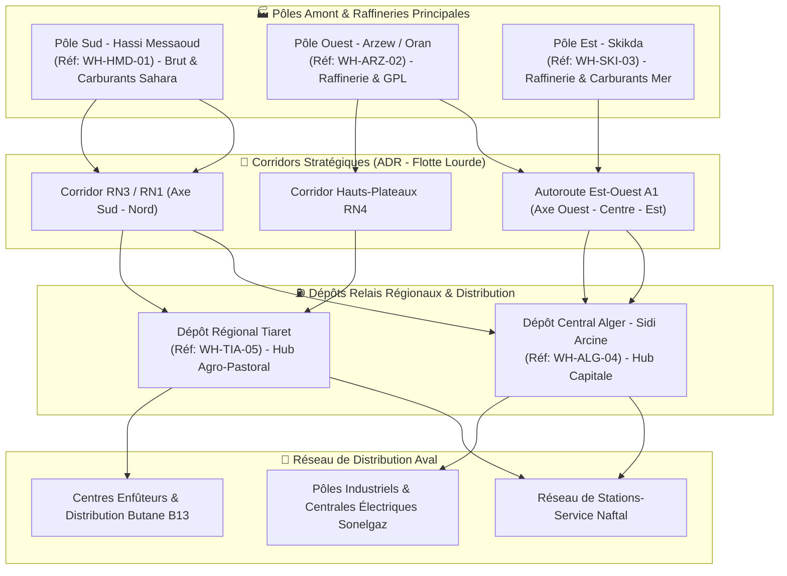
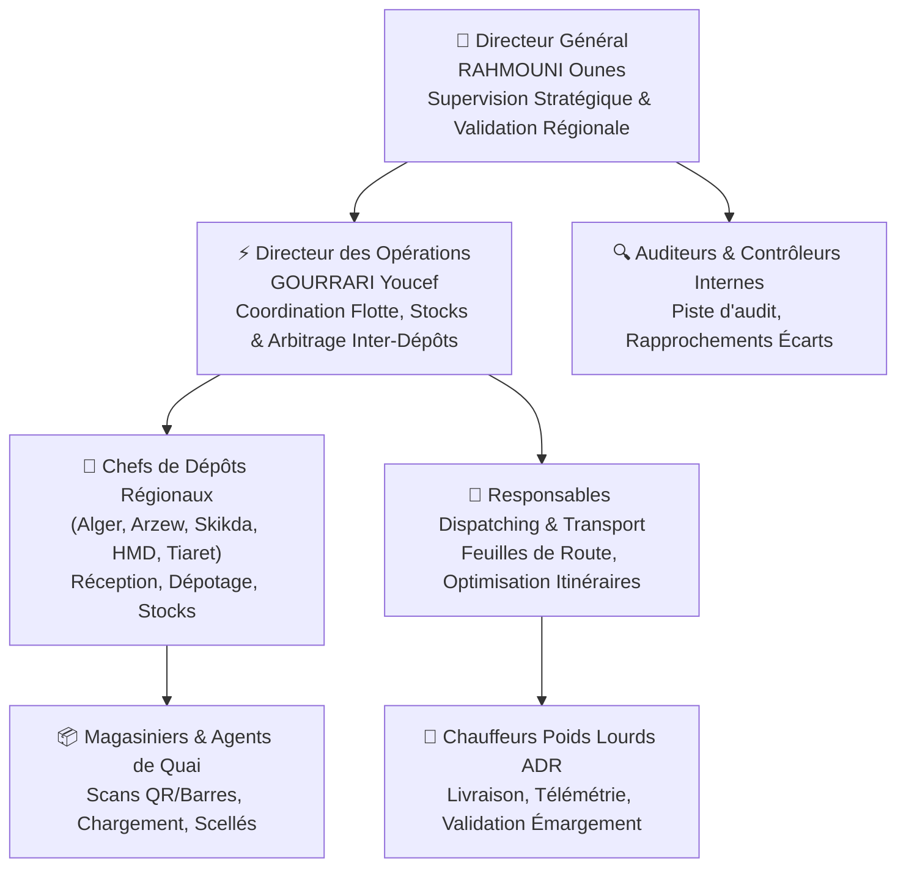
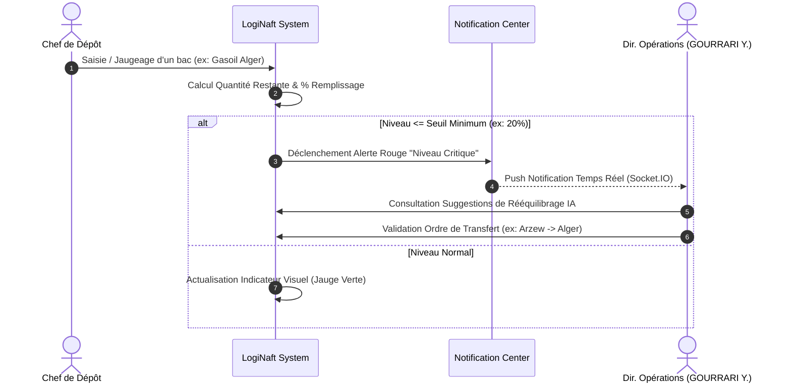
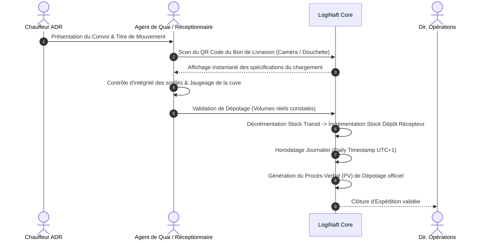

# 📘 DOSSIER D'ARCHITECTURE MÉTIER & SPÉCIFICATIONS FONCTIONNELLES
## Système Numérique Intégré : LogiNaft Smart System
### Plateforme Intelligente de Gestion et de Simulation de la Chaîne Logistique Énergétique en Algérie

---

## 🏛️ 1. FICHE SIGNALÉTIQUE & GOUVERNANCE EXÉCUTIVE

| Élément | Caractéristique |
| :--- | :--- |
| **Nom de la Solution** | **LogiNaft Smart System** (نظام لوجي نفط الذكي) |
| **Secteur d'Activité** | Supply Chain Énergétique Aval (*Downstream Oil & Gas Logistics*) |
| **Périmètre Géographique** | République Algérienne Démocratique et Populaire (Territoire National) |
| **Écosystème de Référence** | Modèle opérationnel **Sonatrach** (Amont/Raffinage) & **Naftal** (Stockage/Distribution/Commercialisation) |
| **Langues de Travail** | Trilingue natif : **Arabe (العربية)**, **Français (FR)**, **Anglais (EN)** avec support RTL/LTR instantané |
| **Directeur Général (المدير العام)** | **RAHMOUNI Ounes** (*رحموني وناس*) |
| **Directeur des Opérations (مدير العمليات)** | **GOURRARI Youcef** (*قوراري يوسف*) |
| **Cadre de Présentation** | Projet Professionnel & Soutenance Académique d'Excellence |

---

## 🎯 2. CONTEXTE STRATÉGIQUE & PROBLÉMATIQUE MÉTIER

### 2.1. Les Enjeux Critiques de la Logistique des Hydrocarbures en Algérie
L'Algérie est le plus vaste pays d'Afrique (2,38 millions de km²). La continuité de l'approvisionnement en produits pétroliers et gaziers constitue une **question de sécurité nationale et de souveraineté économique**.

Les défis majeurs rencontrés sur le terrain incluent :
1. **L'immensité des distances de transit :** Les centres de raffinage et de liquéfaction (Hassi Messaoud, Arzew, Skikda) sont souvent distants de 600 à 1 400 km des bassins de consommation (Alger, Constantine, Oran, Hauts-Plateaux, Grand Sud).
2. **La gestion de la saisonnalité et de la tension sur la demande :** Pics de demande en Gaz Butane (B13) et Propane (P35) durant l'hiver dans les régions montagneuses et rurales ; fortes tensions sur le Gasoil pour les transports et l'agriculture durant les campagnes estivales.
3. **Le respect des normes de sécurité ADR :** Le transport de matières dangereuses (Classe 2 : Gaz liquéfiés ; Classe 3 : Carburants liquides inflammables) impose un contrôle draconien de l'état de la flotte, des vitesses autorisées, et des qualifications des chauffeurs.
4. **La maîtrise des coûts et de l'empreinte carbone :** À 29,01 DZD/litre de gasoil, la consommation moyenne d'un ensemble routier lourd (semi-remorque citerne de 40 000 L) avoisine 34 L/100 km. Réduire les kilomètres à vide (*empty miles*) et optimiser les corridors routiers (RN1, RN3, RN4, Autoroute Est-Ouest A1) génère des économies de carburant substantielles et réduit l'empreinte carbone.
5. **La traçabilité et la transparence des flux :** Prévention des pertes volumétriques (évaporation, écarts de jaugeage thermique à 15°C, prélèvements non autorisés) par des scellés électroniques, des scans de conformité (QR/Code-barres) et un journal d'audit immuable.

### 2.2. La Mission de LogiNaft Smart System
**LogiNaft** a été conçu pour unifier l'ensemble des maillons de la chaîne logistique :
- **Centraliser** la visibilité sur les stocks de carburants et GPL en temps réel à l'échelle nationale.
- **Automatiser** le dispatching des ordres de transport et la traçabilité de la flotte par géolocalisation continue (télémétrie GPS).
- **Sécuriser** chaque étape par des documents légaux horodatés (Bons de Livraison, PV de dépotage, Factures, Titres de mouvement).
- **Assister** les décideurs grâce à des algorithmes d'optimisation d'itinéraires et un Moteur d'IA conversationnel connecté à la base de données opérationnelle.

---

## 🗺️ 3. TOPOLOGIE DU RÉSEAU LOGISTIQUE MODÉLISÉ

Le système orchestre les flux entre les nœuds névralgiques du pays :

### 3.1. Nomenclature des Produits Gérés
1. **Gasoil 10 PPM (مازوت ممتاز) :** Carburant diesel ultra-propre pour moteurs modernes et transport lourd.
2. **Super Sans Plomb 95 (بنزين خالي من الرصاص 95) :** Carburant principal des véhicules légers urbains.
3. **Essence Normale (بنزين عادي) :** Pour usages industriels et parc captif.
4. **Jet A-1 (وقود الطائرات) :** Carburant aviation haute spécificité pour les aéroports nationaux (Alger Houari Boumédiène, Hassi Messaoud Oued Irara...).
5. **Gaz Butane B13 (قارورات غاز بوتان 13 كلغ) :** Produit de première nécessité pour le chauffage et la cuisson domestique.
6. **Gaz Propane P35 (قارورات غاز بروبان 35 كلغ) :** Usages semi-industriels, avicoles et chaufferies collectives.
7. **Huiles & Lubrifiants Spéciaux (زيوت محركات صناعية) :** Gammes Naftal pour turbines, engins de forage et moteurs thermiques.
8. **Équipements & Vannes de Sécurité ADR (معدات السلامة والمحابس) :** Flexibles armés, scellés de sécurité, raccords dry-break.

---

## 👥 4. ACTEURS, ORGANIGRAMME & MATRICE DES RESPONSABILITÉS (RBAC)

La plateforme implémente un contrôle d'accès basé sur les rôles (**Role-Based Access Control - RBAC**), garantissant le principe de moindre privilège et la ségrégation des fonctions :

### 4.1. Fiches de Postes Métier et Droits Associés

| Rôle Métier | Missions Principales | Habilitations LogiNaft |
| :--- | :--- | :--- |
| **Directeur Général (RAHMOUNI Ounes)** | Décision stratégique, veille de continuité d'activité, reporting ministériel et gouvernance. | Accès total : Tableaux de bord macro, KPI nationaux, rapports d'audit, validation finale des audits et des paramètres système. |
| **Directeur des Opérations (GOURRARI Youcef)** | Conduite opérationnelle de la logistique, équilibrage des stocks inter-bassins, résolution des alertes de crise. | Accès opérationnel complet : Dispatching, transfert de stocks, assignation de flotte, analyse des retards, validation des ordres de mission. |
| **Chef de Dépôt / Responsable d'Exploitation** | Gestion physique du parc de cuves/bacs, conformité des réceptions, gestion du personnel de quai. | Gestion du stock local, déclenchement d'alertes de réapprovisionnement, émargement des PV de réception, visualisation des arrivages. |
| **Magasinier / Agent de Quai** | Exécution des mouvements physiques de stock, scan des scellés et des produits, contrôle quantitatif. | Scan QR/Code-barres, saisie des mouvements (Entrée, Sortie, Transfert, Ajustement), édition des étiquettes et des bons de préparation. |
| **Chauffeur Poids Lourd ADR** | Acheminement sécurisé des hydrocarbures, respect des protocoles de conduite et des fenêtres horaires. | Vue restreinte sur terminal mobile : Ordre de mission actif, navigation GPS, signalement d'étape (Départ, En transit, Arrivé). |
| **Auditeur & Contrôleur de Gestion** | Analyse des discordances volumétriques, vérification de conformité comptable et anti-fraude. | Consultation intégrale du registre d'audit (Audit Trail), comparaison des états avant/après, exportation de rapports certifiés. |

---

## ⚙️ 5. PROCESSUS MÉTIER DÉTAILLÉS (WORKFLOWS OPÉRATIONNELS)

### 5.1. Processus de Gestion Volumétrique & Détection des Seuils Critiques

### 5.2. Processus d'Expédition, Ordre de Mission & Sécurité ADR
1. **Création de la Mission :** L'opérateur sélectionne les produits, volumes, le dépôt expéditeur et le client destinataire.
2. **Affectation Ressources :** Sélection d'un camion citerne (ex: Mercedes Actros 40 000 L certifié ADR) et d'un chauffeur détenant l'attestation de formation transport de matières dangereuses valide.
3. **Optimisation d'Itinéraire (Route Optimization) :**
   - Le système calcule la distance réelle, la durée estimée et la consommation théorique (34 L/100 km).
   - Comparaison entre le tracé standard et le tracé optimisé par l'algorithme (économie de carburant en Litres et en Dinars Algériens DZD).
4. **Scellement & Remise des Documents :**
   - Génération automatique du Bon de Livraison (BL) et de l'Ordre de Transport avec **QR code d'authentification**.
   - Pose et enregistrement des numéros de scellés sur les vannes de vidange.

### 5.3. Processus de Suivi Télématique en Direct & Gestion des Dérives (Aléas)
- **Télémétrie GPS :** Le véhicule émet ses coordonnées en direct via le simulateur ou le boîtier embarqué.
- **Contrôle de l'ETA (Estimated Time of Arrival) :** Le système confronte en permanence la position instantanée avec l'heure limite contractuelle.
- **Détection Automatique de Retard :**
  - Si `Heure Courante > Date Limite Estimée (ETA)` et que le statut est toujours `In Transit`, le système bascule automatiquement le statut de l'expédition en **"Delayed" (Retardée)**.
  - Une notification prioritaire est émise à la Direction des Opérations pour prise en charge (dépannage, relève ou avertissement de la station destinataire).

### 5.4. Processus de Réception, Dépotage & Clôture Légale

---

## 📄 6. RÉFÉRENTIEL DES DOCUMENTS MÉTIER & CONFORMITÉ LÉGALE

Conformément à la législation algérienne sur le commerce et le transport des hydrocarbures, la plateforme génère en PDF natif vectoriel haute fidélité les documents suivants :

| Document | Rôle Métier & Utilisation | Éléments Obligatoires Intégrés |
| :--- | :--- | :--- |
| **Bon de Livraison (BL)** | Titre officiel accompagnant la marchandise sur route nationale. Fait foi en cas de contrôle de gendarmerie / police des frontières. | Référence unique, Entête LogiNaft, Dépôt départ/arrivée, Matricule citerne, Nom chauffeur, Volumes en Litres/Kg, QR Code d'authenticité, Blocs signatures. |
| **Procès-Verbal de Dépotage (PV)** | Rapprochement contradictoire entre les volumes expédiés et les volumes réellement vidotés dans les cuves de réception. | Constat d'intégrité des scellés, température de dépotage (°C), densité mesurée, écarts admissibles, visa du chef de dépôt. |
| **Facture Commerciale / Réglementée** | Pièce comptable pour la facturation des volumes livrés aux distributeurs et industriels. | Montant unitaire réglementé en DZD (fixé par l'État), TVA applicable, montants hors taxe et TTC, coordonnées bancaires d'entreprise. |
| **Ordre de Transport / Mission ADR** | Ordre de mission délivré au chauffeur poids lourd avant le départ du terminal de chargement. | Itinéraire imposé, points de halte sécurisés autorisés, consignes de sécurité anti-incendie, numéros d'urgence (Protection Civile 14). |
| **État Récapitulatif d'Inventaire** | Rapport périodique pour la direction générale et les commissaires aux comptes. | Stock physique, valeur valorisée en DZD, taux de rotation, seuils d'alerte atteints par produit. |
| **Liste de Colisage (Packing List)** | Pour les opérations de cabotage maritime ou de transit transfrontalier vers les pays limitrophes. | Poids brut, poids net, nombre de fûts/bouteilles, numéros de lots et marquages d'identification. |

---

## 📊 7. INDICATEURS DE PERFORMANCE CLÉS (KPIs MÉTIER)

Le tableau de bord de **LogiNaft** synthétise en continu les métriques fondamentales suivantes :

1. **Taux de Ponctualité OTIF (*On-Time In-Full*) :**
   $$\text{OTIF} = \left( \frac{\text{Expéditions livrées sans retard et sans manquant}}{\text{Total des expéditions réalisées}} \right) \times 100$$
   *Cible métier : $\ge 98.5\%$*.

2. **Taux de Couverture des Stocks (*Days of Supply*) :**
   $$\text{Couverture (jours)} = \frac{\text{Stock Actuel disponible}}{\text{Consommation moyenne journalière}}$$
   *Permet d'anticiper les ruptures dans les wilayas isolées avant 72 heures ouvrées.*

3. **Indice d'Efficacité Énergétique de la Flotte :**
   - Consommation moyenne constatée vs théorique ($34\text{ L}/100\text{ km}$).
   - Coût kilométrique moyen en Dinars Algériens :
     $$\text{Coût Carburant} = \text{Distance (km)} \times \left(\frac{34}{100}\right) \times 29.01\text{ DZD}$$

4. **Taux de Rotation des Bacs (*Tank Turnover Rate*) :**
   - Mesure la vitesse d'évacuation des carburants pour éviter le vieillissement des produits sensibles (notamment le Sans Plomb 95).

5. **Taux d'Incidents & Écarts d'Audit (*Discrepancy Rate*) :**
   - Volume total d'écarts de jaugeage rapporté aux volumes manipulés, tracé de manière inaltérable dans l'Audit Trail.

---

## 🤖 8. APPORTS DE L'INTELLIGENCE ARTIFICIELLE & INNOVATIONS NUMÉRIQUES

### 8.1. Moteur d'Assistance Conversationnelle Logistique (AI Assistant)
- **Requêtage en Langage Naturel (Arabe, Français, Anglais) :** Permet à un directeur d'exploitation de poser des questions vocales ou textuelles complexes :
  - *« Quelle est la situation des stocks de gasoil à Alger aujourd'hui ? »*
  - *« ماهي الشحنات المتأخرة حالياً في الطريق نحو تقرت ؟ »*
  - *« Which warehouse is currently at risk of stockout? »*
- **Analyse Prédictive & Recommandations Proactives :** Le système ne se limite pas à donner des chiffres bruts ; il propose des arbitrages opérationnels :
  - *Exemple :* Détection d'un stock de Sans Plomb bas à Tiaret couplé à un excédent à Arzew $\rightarrow$ Suggestion immédiate d'un ordre de transfert de 80 000 L via la RN4.

### 8.2. Horodatage Quotidien Strict (*Daily Timestamp System*)
- Enregistrement systématique de l'heure locale algérienne (**Africa/Algiers - UTC+1**) sur toute transaction.
- Horloge temps réel affichée en tête de toutes les interfaces pour une synchronisation absolue des équipes opérationnelles lors des relèves de postes (*shifts* matin / soir).

### 8.3. Piste d'Audit Immuable (*Immutable Ledger*)
- Chaque opération (création, modification, annulation) est enregistrée avec :
  - Identité numérique de l'opérateur (`performedBy`).
  - Rôle et matricule professionnel.
  - Adresse IP source et horodatage milliseconde.
  - Image comparative des données **Avant** et **Après** modification.
  - Impossibilité absolue de suppression dans la base de données.

---

## 🎓 9. CONCLUSION & VALEUR ACADÉMIQUE / PROFESSIONNELLE

Le projet **LogiNaft Smart System** dépasse le cadre d'un simple projet informatique pour s'ériger en **véritable progiciel métier de Supply Chain Énergétique**. Il conjugue :
1. **L'authenticité métier algérienne :** Nœuds logistiques réels, terminologie locale, prix réglementés, carburants normalisés, distances sahariennes et contraintes du code de la route algérien.
2. **L'excellence technique MERN :** Architecture moderne, temps réel via WebSockets, réactivité mobile, cartes interactives sans dépendance payante, et sécurité des données.
3. **Une gouvernance transparente :** Mise en valeur claire de la direction générale (**RAHMOUNI Ounes**) et de la direction des opérations (**GOURRARI Youcef**).
4. **Une conception adaptée aux utilisateurs non techniciens :** Interface intuitive, bascule multilingue instantanée avec gestion parfaite du RTL arabe, alertes visuelles claires et recherche par code-barres.
